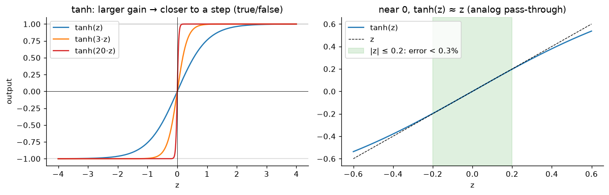
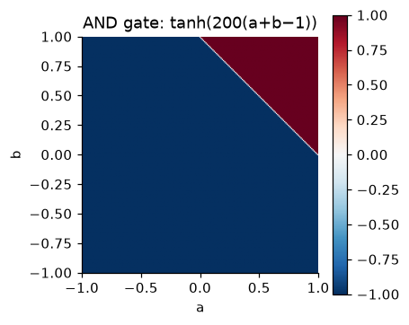
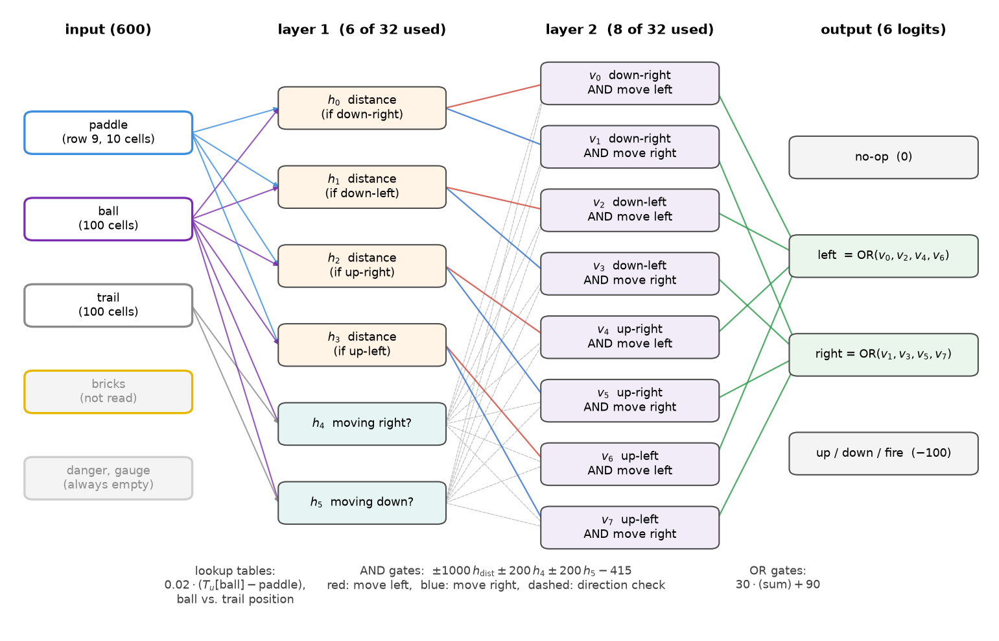
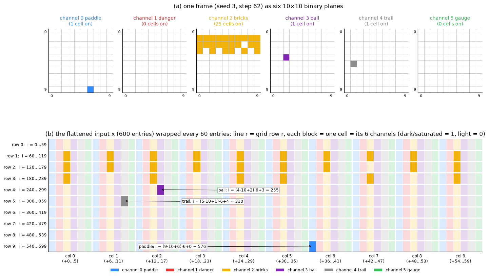
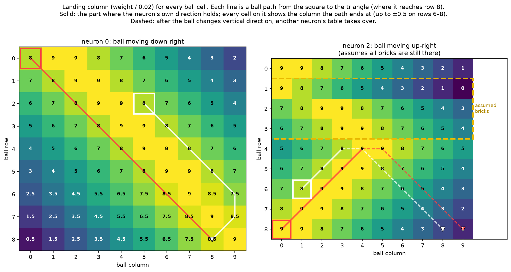

+++
date = '2026-11-07T12:00:00+02:00'
draft = false
title = 'Sparks of Weight-Space Programming? Probably Not'
description = 'Reverse engineering the Breakout network Astra wrote from scratch'
tags = ['machine learning', 'reverse engineering', 'neural networks']
math = true
build = { list = 'never' }
+++

As long as you are living on Earth you have probably stumbled upon a [blog post](https://rikiyat.github.io/blog/weight-space-programming/) about Astra reading and writing neural network weights, which concludes:

> These results show sparks of Weight-Space Programming, which may extend beyond what we’d expect from humans or conventional algorithms.

Sean Goedecke already covered the weight *reading and editing* experiments (identifying the game from the weights and fixing Qwen's math) in [LLMs are not superhuman at reading and writing neural network weights](https://www.seangoedecke.com/llms-are-not-superhuman-at-reading-and-writing-neural-network-weights/), showing that a competent ML researcher could do the same. He skipped the experiment I find the most interesting, writing a network from scratch:
> The most impressive one I'm skipping is hand-writing a neural network from scratch. While cool, if you can express a task as a simple program, we already know it's possible to express that program as a NN

The original post agrees that this is how Astra did it:
> Astra reasons about the desired programs it wants each network to implement and converts them into neural form

The question is whether this is really a spark of something beyond humans and conventional algorithms. Sean's point is that it is possible in principle. In this post I show that it is exactly what happened: I reverse engineer by hand the network Astra wrote for Breakout and show that it is a short python program built from standard gates, something a human can write and a compiler could automate.

But first, let's start by answering the following question from the blog post:

> If you were asked to handcraft a neural network that plays Go, what would you do? ... For almost any human, this is practically impossible.

Well, as a human, I can tell you exactly what I would do step by step:
1. Decide on the algorithm, implement it in python and evaluate it to make sure it achieves sufficient results.
2. Convert it into a circuit with addition, subtraction, zero-check and other gates (AND, OR, ...).
3. Implement the circuit as a Neural Network.

For Go, step 1 is the hard part: you need a decent Go algorithm before there is anything to compile (and the original Go experiment also gave Astra up to 50 rounds of feedback). But nothing here is "black magic". The steps are the same for any task and only step 1 depends on how hard the task is. The question is how we can implement a circuit as a Neural Network (step 3). By now (hopefully) most engineers and computer scientists remember that any boolean circuit can be built from NAND gates alone (a *universal*, or *functionally complete*, gate).

The Go network is too big to read by hand, so I will show it on the network Astra wrote for Breakout, which is small enough to read completely. Astra's full response and weights are available in the original authors' logs ([RikiyaT/lm_understand-logs](https://github.com/RikiyaT/lm_understand-logs)).

## Implementing circuits as Neural Networks
We first need to understand the primitives that we can use. In the case of the Breakout game experiment, we are given control of a network with 3 linear layers (600 -> 32 -> 32 -> 6). The first two are each followed by a `tanh` activation. The last one has no activation: its 6 outputs are logits, one per action, and the action is sampled from their softmax.

In simple terms, each layer defines a set of variables (or neurons) of the following form:
$$
V_i=\tanh(W[0,i]H[0] + W[1,i]H[1] + ... + b[i])
$$

Where $H$ are the variables of the previous layer, starting with the input, and $b[i]$ is a constant (the bias). Note that the first index of $W$ is the input and the second is the neuron (the same as in Astra's code below). Notice that if, for example, $V_0$ sets $W[:,0] = (1, 1, 0, ..., 0)$, then it only depends on $H[0]$ and $H[1]$. The bias is part of what lets us build gates.

Next, we need to understand what this $\tanh$ function is, which is the key factor for implementing boolean gates. The $\tanh$ function maps any real number into $(-1, 1)$, and it has two interesting regions that we can take advantage of:
1. Boolean Region. For $|z| \gtrsim 3$, $\tanh(z)$ is within 0.005 of $\pm 1$. If we compute $\tanh(1000 z)$, then we get $-1$ if $z$ is negative and $+1$ if positive (unless $z$ is very close to 0).
2. Linear Region. For $|z| \lesssim 0.3$, $\tanh(z) \approx z$.



From now on, we treat $-1$ as False and $1$ as True. We say a neuron *fires* when it outputs $+1$ and is *dormant* when it outputs $-1$. (The raw inputs of the network are $0$ and $1$ rather than $\pm1$. That only changes the bias of the first layer's gates.)

### Every Neuron is a logic gate
We have something better than NAND: every neuron is a threshold gate. By choosing its weights and bias, one neuron can be AND, OR, NAND, NOT, a comparator, or even a lookup table.

#### Implementing AND gate
Take two boolean inputs $a,b\in \{-1, +1\}$. Then
$$ y = \tanh(200(a + b  - 1))$$
is an AND gate.

The general idea is that $a+b-1$ is positive if both $a$ and $b$ are True and negative if at least one is False. Then, multiplying by a large constant (200), we enter the boolean region where $\tanh$ returns the sign of the result. This is easier to see in the following heatmap:


If the inputs are $\{0, 1\}$ instead of $\pm1$ (as in the network's first layer), the same gate just needs a different bias: $y = \tanh(200(a + b - 1.5))$.

#### Implementing OR gate
Take two boolean inputs $a,b\in \{-1, +1\}$. Then
$$ y = \tanh(200(a + b  + 1))$$
is an OR gate.

It is the same neuron as AND with a different bias: $a+b+1$ is negative only when both $a$ and $b$ are False. With $\{0,1\}$ inputs it becomes $\tanh(200(a + b - 0.5))$. In general, the bias sets how many inputs must be True for the neuron to fire.

#### Implementing NOT gate
Take boolean input $a\in \{-1, +1\}$. Then
$$ y = \tanh(-200a)$$
is a NOT gate.

In practice, we don't even need a neuron for it. The next layer multiplies its inputs by weights, so NOT is just a negative weight. For example, $\tanh(200(-a + b - 1))$ computes $(\lnot a) \land b$ in one neuron.

#### Implementing a Comparator
This is where we start seeing the strength of using neurons instead of simple gates. One neuron can also be used as a comparator checking if $a > b$, when $a$ and $b$ are continuous values (for example, outputs of neurons in the linear region). Take continuous inputs $a$ and $b$. Then
$$ y = \tanh(K(a - b - \theta))$$
returns $+1$ (True) if $a > b + \theta$ and $-1$ (False) if $a < b + \theta$. It is important to choose $K$ large enough so that we are in the boolean region and not the linear one.

## Reverse engineering Astra's Breakout Neural Network
We start by reviewing Astra's response to the user prompt:
>The first layer computes four landing-position errors and two direction indicators. Descending predictions include wall reflections; ascending predictions anticipate the earliest possible brick bounce and revise as the ball climbs. Early positioning favors preserving horizontal direction to sweep through bricks; near the bottom, either valid catch column is accepted. The second layer gates left/right decisions, choosing no-op when positioned correctly.

From this response alone, we can see that there is some kind of logic embedded into the weights themselves, which strongly suggests that Astra programmed the logic into the weights similarly to what is shown above.

Looking at the weights it is also apparent that out of 20K possible parameters, very few are actually used: **only 815 of the 20,486 parameters are non-zero**.

Before going over the weights, here is the whole network as a circuit. We will go over it from left to right:



### Game Frame Vectorization
The NN never receives an image of the game frames. Each frame is a 10×10 grid with 6 binary channels (one 10×10 plane per kind of object), and it is **flattened** into a vector $x$ of 600 zeros and ones:

$$i = (\text{row}\cdot 10 + \text{col})\cdot 6 + \text{channel}$$

This information is given to Astra as part of the prompt, and is better explained in the following image:


Astra writes the weights with python slices. Since every cell takes 6 entries and every row takes 60, a stride of 6 walks along a row (in one channel) and a stride of 60 walks down a column (in one channel). For example, `540:600:6` is channel 0 in the 10 cells of row 9, and `3:600:60` is channel 3 in the 10 cells of column 0.

### First Layer
Understanding the frame representation, we can now analyze line by line the weights chosen by Astra. Starting with the following 4 lines:
```python
W1[540:600:6, 0] = [0, -0.02, -0.04, -0.06, -0.08, -0.10, -0.12, -0.14, -0.16, -0.18]
W1[540:600:6, 1] = [0, -0.02, -0.04, -0.06, -0.08, -0.10, -0.12, -0.14, -0.16, -0.18]
W1[540:600:6, 2] = [0, -0.02, -0.04, -0.06, -0.08, -0.10, -0.12, -0.14, -0.16, -0.18]
W1[540:600:6, 3] = [0, -0.02, -0.04, -0.06, -0.08, -0.10, -0.12, -0.14, -0.16, -0.18]
```
This block of weights writes the same 10 weights into each of the **first four neurons**. The slice `540:600:6` picks channel 0 (the paddle) in each of the 10 cells of the bottom row. Since the paddle occupies exactly one of these cells, only one of them is equal to $1$ and the others are $0$. This essentially implements a lookup table that computes $-0.02x$ where $x$ is the paddle's column.

What follows are a set of blocks each implementing a different lookup table. For simplicity, let's focus on the first neuron's additional weights:
```python
# Ball row 0.
W1[3:60:6, 0] = [0.16, 0.18, 0.18, 0.16, 0.14, 0.12, 0.10, 0.08, 0.06, 0.04]

# Ball row 1.
W1[63:120:6, 0] = [0.14, 0.16, 0.18, 0.18, 0.16, 0.14, 0.12, 0.10, 0.08, 0.06]

# Ball row 2.
W1[123:180:6, 0] = [0.12, 0.14, 0.16, 0.18, 0.18, 0.16, 0.14, 0.12, 0.10, 0.08]

# Ball row 3.
W1[183:240:6, 0] = [0.10, 0.12, 0.14, 0.16, 0.18, 0.18, 0.16, 0.14, 0.12, 0.10]

# Ball row 4.
W1[243:300:6, 0] = [0.08, 0.10, 0.12, 0.14, 0.16, 0.18, 0.18, 0.16, 0.14, 0.12]

# Ball row 5.
W1[303:360:6, 0] = [0.06, 0.08, 0.10, 0.12, 0.14, 0.16, 0.18, 0.18, 0.16, 0.14]

# Ball row 6: descending targets become catch-interval midpoints.
W1[363:420:6, 0] = [0.05, 0.07, 0.09, 0.11, 0.13, 0.15, 0.17, 0.18, 0.17, 0.15]

# Ball row 7.
W1[423:480:6, 0] = [0.03, 0.05, 0.07, 0.09, 0.11, 0.13, 0.15, 0.17, 0.18, 0.17]

# Ball row 8.
W1[483:540:6, 0] = [0.01, 0.03, 0.05, 0.07, 0.09, 0.11, 0.13, 0.15, 0.17, 0.18]
```
Those weights are multiplied by channel 3 (ball location), another lookup table which according to Astra assumes the ball descends down-right. Dividing this table by 0.02 to align it with the paddle location scaling we get:
| ball row \ ball col | 0 | 1 | 2 | 3 | 4 | 5 | 6 | 7 | 8 | 9 |
|---|---|---|---|---|---|---|---|---|---|---|
| **0** | **8** | 9 | 9 | 8 | 7 | 6 | 5 | 4 | 3 | 2 |
| **1** | 7 | **8** | 9 | 9 | 8 | 7 | 6 | 5 | 4 | 3 |
| **2** | 6 | 7 | **8** | 9 | 9 | 8 | 7 | 6 | 5 | 4 |
| **3** | 5 | 6 | 7 | **8** | 9 | 9 | 8 | 7 | 6 | 5 |
| **4** | 4 | 5 | 6 | 7 | **8** | 9 | 9 | 8 | 7 | 6 |
| **5** | 3 | 4 | 5 | 6 | 7 | **8** | 9 | 9 | 8 | 7 |
| **6** | 2.5 | 3.5 | 4.5 | 5.5 | 6.5 | 7.5 | **8.5** | 9 | 8.5 | 7.5 |
| **7** | 1.5 | 2.5 | 3.5 | 4.5 | 5.5 | 6.5 | 7.5 | **8.5** | 9 | 8.5 |
| **8** | 0.5 | 1.5 | 2.5 | 3.5 | 4.5 | 5.5 | 6.5 | 7.5 | **8.5** | 9 |

The connection to the game is easier to see when drawing ball paths on top of the table. Every cell on the path of a ball descending right shows the same column, the one where the path reaches the bottom, and the table folds exactly where the ball bounces off the right wall:



Looking at rows 0 up to 5 it is clear that they represent the column the ball arrives at when descending right, including the reflection from the right wall. Rows 6-8 contain less pretty values that are not entirely clear, but they will become clear in the next layer.
Anyway, we now understand that the first neuron computes: $$0.02\cdot(DESCEND\_RIGHT\_LOC[ball_{row},ball_{col}] - paddle)$$
The distance between the paddle and the estimated ball impact location. This is exactly what Astra's response says:
>Units 0..3: descending-right, descending-left, ascending-right, ascending-left. Subtract paddle position from each target.

Neurons 1-3 are the same with their own tables. One detail worth noticing: the ascending tables (neurons 2 and 3, right side of the image above) assume all the bricks are still there, since no neuron in the network reads the brick channel at all.

One more part is left for calculating those 4 neurons:
```python
# Terminal-row fallback.
W1[543:600:6, 0] = [0, 0.02, 0.04, 0.06, 0.08, 0.10, 0.12, 0.14, 0.16, 0.18]
W1[543:600:6, 1] = [0, 0.02, 0.04, 0.06, 0.08, 0.10, 0.12, 0.14, 0.16, 0.18]
W1[543:600:6, 2] = [0, 0.02, 0.04, 0.06, 0.08, 0.10, 0.12, 0.14, 0.16, 0.18]
W1[543:600:6, 3] = [0, 0.02, 0.04, 0.06, 0.08, 0.10, 0.12, 0.14, 0.16, 0.18]
```
Those weights are another lookup table adding $0.02 \cdot ball_{col}$ to each neuron as long as the ball is on the paddle row. In practice, those weights are not used. According to the game python script, this case means game over. I verified those weights are not relevant by zeroing them and running the evaluation with the same seeds on both the original and the modified weights: the metrics are identical on 3 seeds x 1,000 episodes. The same holds when zeroing every weight on a ball or trail in row 9, which means 75 of the 815 non-zero weights (9%) can never affect the game.

We have covered most of layer 1 logic. There are two more neurons to cover before we can move on to the next layer.
```python
# Unit 4: horizontal direction, including stationary wall-reflection frames.
W1[3:600:60, 4] = 10
W1[9:600:60, 4] = 20
W1[15:600:60, 4] = 40
...
W1[57:600:60, 4] = 170

W1[10:600:60, 4] = -20
W1[16:600:60, 4] = -40
...
W1[58:600:60, 4] = -180
```
<details>
<summary>All 19 lines</summary>

```python
W1[3:600:60, 4] = 10
W1[9:600:60, 4] = 20
W1[15:600:60, 4] = 40
W1[21:600:60, 4] = 60
W1[27:600:60, 4] = 80
W1[33:600:60, 4] = 100
W1[39:600:60, 4] = 120
W1[45:600:60, 4] = 140
W1[51:600:60, 4] = 160
W1[57:600:60, 4] = 170

W1[10:600:60, 4] = -20
W1[16:600:60, 4] = -40
W1[22:600:60, 4] = -60
W1[28:600:60, 4] = -80
W1[34:600:60, 4] = -100
W1[40:600:60, 4] = -120
W1[46:600:60, 4] = -140
W1[52:600:60, 4] = -160
W1[58:600:60, 4] = -180
```
</details>

As the comment suggests, this neuron computes the horizontal direction of the ball taking the ball (channel 3) and the trail (channel 4) into account. The stride of 60 means each line sets a whole column, so only the columns of the ball and the trail matter, computing the following lookup table:

| Ball movement | $z_4$ | $h_4 = \tanh(z_4)$ |
|---|---|---|
| Right, into columns 1–8 | +20 | +1 (right) |
| Right, into column 9 | +10 | +1 (right) |
| Stall at column 0 (wall bounce) | +10 | +1 (right) |
| Left, into columns 1–8 | −20 | −1 (left) |
| Left, into column 0 | −10 | −1 (left) |
| Stall at column 9 (wall bounce) | −10 | −1 (left) |

Astra makes sure that $|z_4|\ge 10$ so that $\tanh$ saturates to $\pm 1$.

Finally, neuron 5's weights are similar to 4 but compute if the ball is currently ascending or descending:
```python
# Unit 5: descending versus ascending; a stationary row-8 frame means paddle bounce.
b1[5] = 5
W1[63:120:6, 5] = 10
W1[123:180:6, 5] = 20
...
W1[483:540:6, 5] = 70
W1[543:600:6, 5] = 90
W1[64:120:6, 5] = -10
W1[124:180:6, 5] = -20
...
W1[544:600:6, 5] = -90
```
<details>
<summary>All 19 lines</summary>

```python
b1[5] = 5
W1[63:120:6, 5] = 10
W1[123:180:6, 5] = 20
W1[183:240:6, 5] = 30
W1[243:300:6, 5] = 40
W1[303:360:6, 5] = 50
W1[363:420:6, 5] = 60
W1[423:480:6, 5] = 70
W1[483:540:6, 5] = 70
W1[543:600:6, 5] = 90
W1[64:120:6, 5] = -10
W1[124:180:6, 5] = -20
W1[184:240:6, 5] = -30
W1[244:300:6, 5] = -40
W1[304:360:6, 5] = -50
W1[364:420:6, 5] = -60
W1[424:480:6, 5] = -70
W1[484:540:6, 5] = -80
W1[544:600:6, 5] = -90
```
</details>

| Ball movement | $z_5$ | $h_5 = \tanh(z_5)$ |
|---|---|---|
| Down, into rows 1–7 | +15 | +1 (down) |
| Down, into row 8 | +5 | +1 (down) |
| Up, into any row | −5 | −1 (up) |
| Stall on rows 0–4 (ceiling or brick bounce) | +5 | +1 (down) |
| Stall on row 8 (paddle bounce) | −5 | −1 (up) |

Overall, the first layer computes 6 neurons: 0-3 compute the distance between the paddle and the future ball location at the bottom, each assuming a different direction, 4 computes the horizontal direction of the ball and 5 computes the vertical direction of the ball.

Two things to notice: neurons 0-3 remain in the linear region of $\tanh$, which means the distances are forwarded to the next layer as they are. Neurons 4 and 5 are in the boolean region and we get boolean values $\pm 1$.

From here, we can guess that layer 2's purpose is to use neurons 4 and 5, together with 0-3 to create simplified neurons to use for the final movement decision.

### Second Layer
Layer 2 weights are defined as follows:
```python
# Four context-gated pairs of left/right comparisons.
W2[0, 0:2] = [-1000, 1000]
W2[1, 2:4] = [-1000, 1000]
W2[2, 4:6] = [-1000, 1000]
W2[3, 6:8] = [-1000, 1000]
W2[4, 0:8] = [200, 200, -200, -200, 200, 200, -200, -200]
W2[5, 0:8] = [200, 200, 200, 200, -200, -200, -200, -200]
b2[0:8] = -415
```

The following table shows the weights used to compute each of the 8 neurons of layer 2. $k_i$ is the weight used with neuron $h_i$ of layer 1.
| neuron $j$ | $k_0$ | $k_1$ | $k_2$ | $k_3$ | $k_4$ | $k_5$ | bias $b_j$ | meaning |
|---|---|---|---|---|---|---|---|---|
| 0 | −1000 | 0 | 0 | 0 | +200 | +200 | −415 | down-right, move left |
| 1 | +1000 | 0 | 0 | 0 | +200 | +200 | −415 | down-right, move right |
| 2 | 0 | −1000 | 0 | 0 | −200 | +200 | −415 | down-left, move left |
| 3 | 0 | +1000 | 0 | 0 | −200 | +200 | −415 | down-left, move right |
| 4 | 0 | 0 | −1000 | 0 | +200 | −200 | −415 | up-right, move left |
| 5 | 0 | 0 | +1000 | 0 | +200 | −200 | −415 | up-right, move right |
| 6 | 0 | 0 | 0 | −1000 | −200 | −200 | −415 | up-left, move left |
| 7 | 0 | 0 | 0 | +1000 | −200 | −200 | −415 | up-left, move right |

For simplicity, let's focus on the first row of layer 2. This neuron computes:
$$\tanh(-1000\cdot h_0+200\cdot h_4 + 200\cdot h_5 - 415)$$

It outputs $1$ only when $h_4=h_5=1$ and $h_0 \lesssim -0.015$. In other words, it's True if the ball descends down-right and the paddle needs to move left.

To understand this, first remember that $h_0$ is a distance value between $-0.18$ and $0.18$ where a negative value means the paddle is to the right of where the ball will land.
In addition, since $h_4$ and $h_5$ are boolean, $200\cdot h_4 + 200\cdot h_5$ result is either $0$, $400$, or $-400$.
Now let's look at the bias, $-415$. It is easiest to read it as $-400 - 15$:
* The $-400$ cancels the direction term, but only when **both** $h_4$ and $h_5$ are $+1$. Otherwise, the direction term is at most $0$, so we get at most $180 - 415 = -235$ and the neuron outputs $-1$.
* The $-15$ is a threshold on the distance. Once the direction is down-right, what is left is $-1000\cdot h_0 - 15$, which is positive only when $-1000\cdot h_0 > 15$. Since $h_0 \approx 0.02\cdot(T_0 - \text{paddle})$, that means the ball target $T_0$ is at least about one column **left** of the paddle (one column gives $+20$, half a column only $+10$).

This also explains the .5 values in rows 6-8 of the first layer's table. In Breakout, the paddle catches the ball if it is either at the ball's current column, which sends the ball straight back up in the same horizontal direction, or at the column the ball is moving into, which sends it back the way it came. Near the bottom, a target like 7.5 is only half a column from both of these columns, so the paddle stays put when it is on either one.

All neurons of this layer follow the same logic. At the end we have 8 neurons, at most one of them fires with $+1$ and the others are dormant. When the paddle is already in place, all of them are dormant.

We are now ready to use those neurons to generate the output of the network telling where to move the paddle.

### Third Layer (Last)
Finally, the last layer is defined by the following weights:
```python
# Near-deterministic movement when needed; otherwise no-op.
W3[0:8:2, 1] = 30
W3[1:8:2, 3] = 30
b3[:] = [0, 90, -100, 90, -100, -100]
```

This layer outputs 6 neurons, one per action. Up, down and fire are part of the standard MinAtar action set, but in Breakout they do nothing, so Astra gives them a constant $-100$ and they are never chosen. The other three are no-op, left and right. No-op always outputs $0$, left computes
$$30\cdot (v_0+v_2+v_4+v_6)+90$$
where $v_j$ are the neurons of layer 2. Remember that a dormant neuron is $-1$ and not $0$. If all four are dormant we get $30\cdot(-4)+90 = -30$, and if one of them fires we get $30\cdot(-3)+30+90 = +30$. Basically implementing an OR gate (the $90$ is the $+3$ of a 4-input OR gate, scaled by 30). Since there is no $\tanh$, the result is compared with no-op's $0$. Similarly right computes an OR gate on the neurons relevant for right movements
$$30\cdot (v_1+v_3+v_5+v_7)+90$$
The action selected always wins by at least 30, so after the softmax its probability is $1 - 10^{-13}$. Even though the action is sampled, the network is deterministic in practice.

### The network
To summarize, the whole network can be written back as the following program:
```python
def astra_program(ball, trail, paddle):
    (br, bc), (tr, tc) = ball, trail
    # neuron 4: horizontal movement
    right = bc > tc if bc != tc else bc == 0
    # neuron 5: vertical movement
    down = br > tr if br != tr else br != 8
    # 0 down-right, 1 down-left, 2 up-right, 3 up-left
    ctx = [[3, 2], [1, 0]][down][right]
    # neurons 0-3: the 4 lookup tables
    target = TABLES[ctx][br][bc]
    # layer 2 + layer 3
    if target - paddle >= 1:
        return RIGHT
    if paddle - target >= 1:
        return LEFT
    return NOOP
```

To verify, I compared `astra_program` with the network on every frame the game can produce: every ball cell, every possible trail cell and every paddle column (4,400 frames). They agree on 100% of them, and `astra_program` gets the same score as the network. Going the other way, from this program back to the weights, is exactly the gate construction from the beginning of this post.

Is the program at least clever? Not really. Astra implements a short program that predicts where the ball will land and moves the paddle there. It completely ignores the bricks channel and assumes every brick is still in place while the ball is ascending, corrects its guess frame by frame, and never aims for the bricks. It only has to keep the ball alive, which is what the score mostly rewards.

## This way of writing weights from scratch is not surprising
Hopefully by now you are convinced that writing neural networks without training is feasible even for a human. That said, you might prefer to write a compiler to make your life easier.

I would like to conclude by showing you the similarities between the way Astra writes neural networks and exploit engineering.

| Writing an exploit | Writing Astra's weights |
|---|---|
| The source code of the target is available | The full `breakout.py` is in the prompt |
| Understand the primitives (gadgets) | `tanh` regions: lookup tables, AND, OR, comparators |
| Understand the memory layout | The frame flattening $i = (\text{row}\cdot 10 + \text{col})\cdot 6 + \text{channel}$ |
| Chain gadgets into a payload | Chain lookup tables → AND gates → OR gates into logic |

Given these similarities, the results are not surprising for Astra: OpenAI reports that it solves 42.4% of the [ExploitGym](https://arxiv.org/abs/2605.11086) benchmark in its own testing, with no time limit ([OpenAI](https://openai.com/index/gpt-6-astra/)). Still, writing weights from scratch with no tools, on the first try in about 8 minutes, is an impressive piece of engineering. But it is the skill of an exploit engineer (Astra is a very good one), not a spark of something beyond what we'd expect from humans or conventional algorithms.
